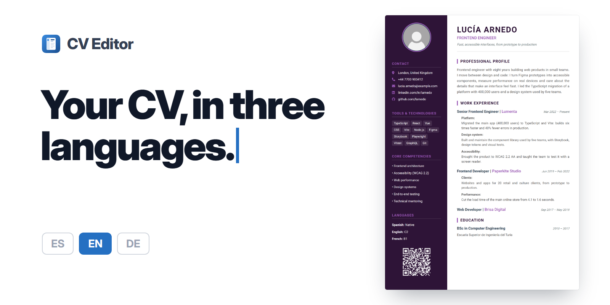
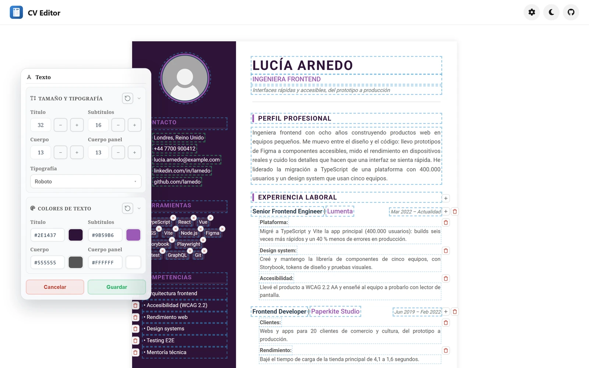
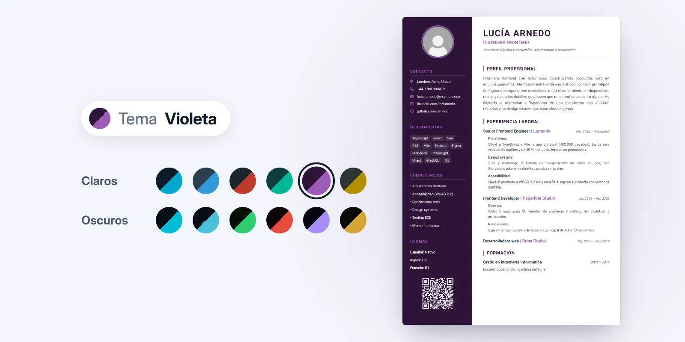
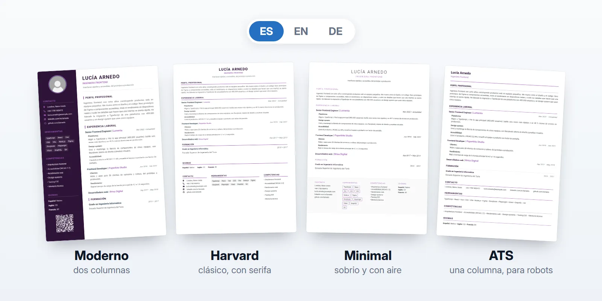
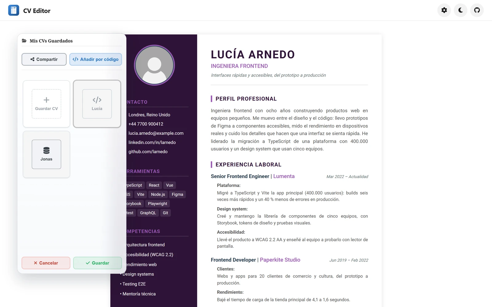

<div align="center">

<p><picture>
  <source media="(prefers-reduced-motion: reduce)" srcset="docs/images/header-still-es.webp">
  
</picture></p>

Un editor de CV que funciona entero en el navegador: 12 temas, 4 formatos, 3 idiomas y un PDF de una cara.<br>
Sin cuentas ni servidor: tu CV se queda en tu ordenador.

<br>

[](#privacidad)
[](#privacidad)
[](#4-formatos-3-idiomas)
[](LICENSE)

<br>

<a href="#qué-hace"><b>Qué hace</b></a> &nbsp;·&nbsp;
<a href="#pruébalo"><b>Pruébalo</b></a> &nbsp;·&nbsp;
<a href="#hazlo-tuyo"><b>Hazlo tuyo</b></a> &nbsp;·&nbsp;
<a href="#cómo-está-hecho"><b>Cómo está hecho</b></a> &nbsp;·&nbsp;
<a href="#privacidad"><b>Privacidad</b></a> &nbsp;·&nbsp;
<a href="README.md"><b>English</b></a>

</div>

## Qué hace

### Escribe sobre la hoja

El CV es una hoja A4 exacta y se edita en el sitio: lo que ves es lo que se imprime. Si algo no cabe, el editor te
avisa antes de imprimir.



### 12 temas, claros y oscuros

Seis paletas, cada una en versión clara y oscura, y tus propias letras, tamaños, espacios y colores.

<p><picture>
  <source media="(prefers-reduced-motion: reduce)" srcset="docs/images/themes-es-still.webp">
  
</picture></p>

### 4 formatos, 3 idiomas

Moderno, Harvard, Minimal y ATS, la columna única que mejor leen los programas de selección de personal. Cada CV tiene
su versión en castellano, en inglés y en alemán: editas una y el editor traduce tus cambios a las otras dos, con
MyMemory, cuando le das permiso.

<p><picture>
  <source media="(prefers-reduced-motion: reduce)" srcset="docs/images/layouts-es-still.webp">
  
</picture></p>

### Todos tus CV, en tu navegador

Guarda hasta 25, con su miniatura. Comparte uno como un código que otra persona pega en el suyo. Deshacer y
rehacer. De muestra vienen dos CV inventados: el de Lucía, ingeniera frontend, y el de Jonas, ingeniero de datos.



### Un PDF de una cara

«Descargar» lo imprime con tu navegador: un PDF de una sola cara, con el texto seleccionable y con el nombre de tu
puesto y su idioma, formato y tema.

## Pruébalo

Hay una demo en la web del autor: **[davidmcaru.com/app/CV/editor](https://davidmcaru.com/app/CV/editor/)**. Es la
versión de esa web, que empieza con una plantilla en blanco y sigue las condiciones de la web; lo demás de esta página
habla del código de este repositorio.

## Hazlo tuyo

Necesitas Node 22.13 o posterior, o Node 24.

```bash
git clone https://github.com/davidmcaru/app-cv-editor
cd app-cv-editor
npm ci
npm run dev
```

1. **Tu CV.** Copia `public/cv/cv-lucia.json`, escribe el tuyo en él y añádelo a `src/cv/cv-profiles.ts`. Tu foto y tu
   QR van en la misma carpeta. Si un JSON no se puede cargar, el editor enseña el que lleva dentro,
   `src/cv/cv-data-default.ts`: pon ahí también el tuyo.
2. **Tu enlace.** En un fork, pon tu repositorio en `src/site/site.config.ts`: la cabecera enlaza a él, como pide la
   licencia.
3. **Publícalo.** `npm run build` deja una web estática en `dist/`, con rutas relativas: funciona desde cualquier
   carpeta de cualquier servidor.

## Cómo está hecho

TypeScript y Vite, sin ningún framework de interfaz. `src/cv/` es el editor; `src/components/`, las piezas
compartidas, y `src/site/`, la cabecera. Las fuentes van en `public/fonts/` y los iconos, en un paquete de npm: no se
pide nada a ninguna CDN.

Comprobaciones: `npm run typecheck`, `npm run lint` y `npm run format:check`. Los tests son de Playwright, en Chromium
y WebKit: una vez, `npx playwright install chromium webkit`, y después `npm test`.

## Privacidad

Tus CV no salen de tu navegador: se guardan en su almacenamiento local. Lo único que se pide fuera es la traducción
automática, a MyMemory, y solo cuando le das permiso.

## Licencia

[AGPL-3.0](LICENSE), de [davidmcaru](https://github.com/davidmcaru) ([davidmcaru.com](https://davidmcaru.com)). Los
avisos de terceros están en [NOTICE.md](NOTICE.md).

Los issues son bienvenidos; los pull requests, por ahora, no.
