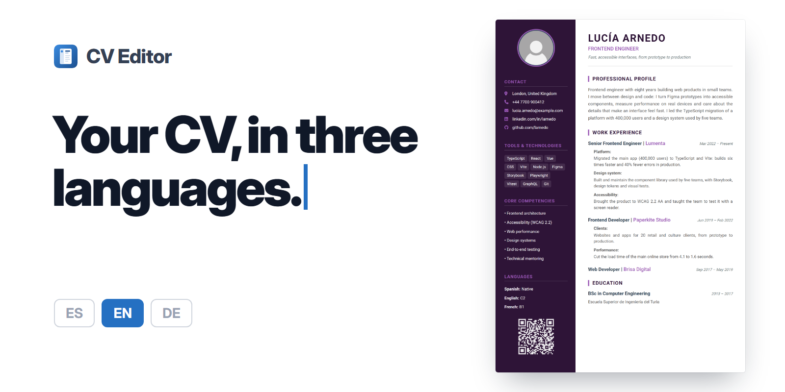
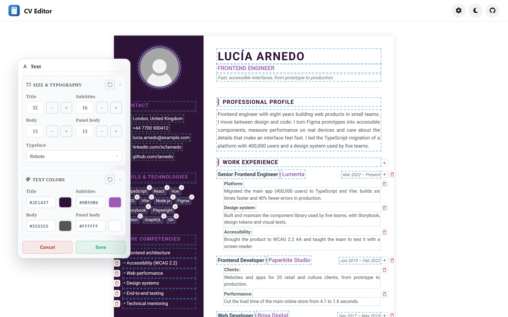
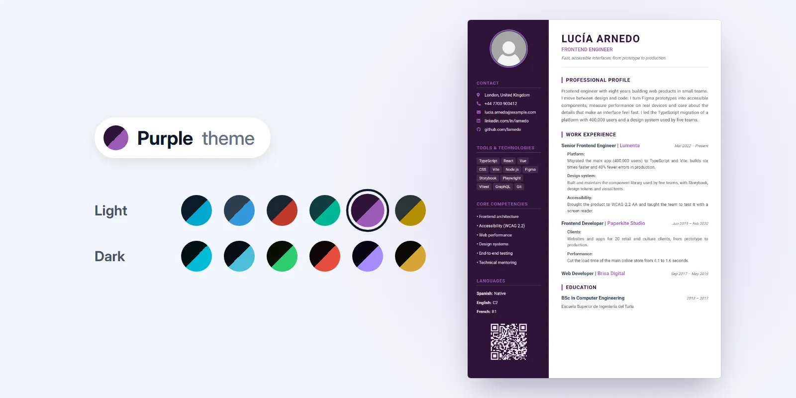
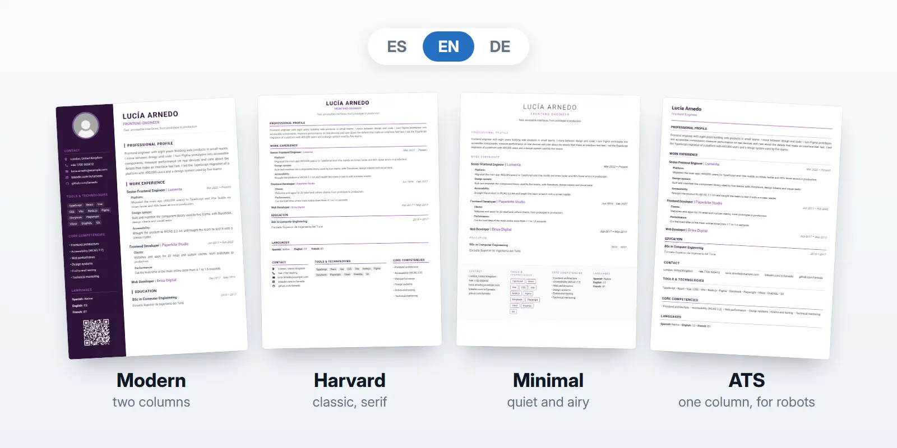
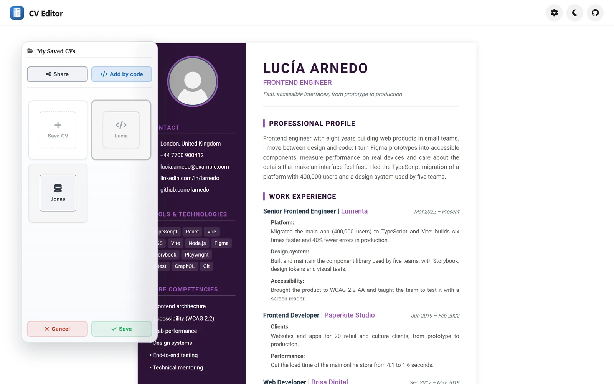

<div align="center">

<p><picture>
  <source media="(prefers-reduced-motion: reduce)" srcset="docs/images/header-still-en.webp">
  
</picture></p>

A CV editor that runs entirely in your browser: 12 themes, 4 layouts, 3 languages and a one-page PDF.<br>
No accounts and no server: your CV stays on your computer.

<br>

[](#privacy)
[](#privacy)
[](#4-layouts-3-languages)
[](LICENSE)

<br>

<a href="#what-it-does"><b>What it does</b></a> &nbsp;·&nbsp;
<a href="#try-it"><b>Try it</b></a> &nbsp;·&nbsp;
<a href="#make-it-yours"><b>Make it yours</b></a> &nbsp;·&nbsp;
<a href="#how-its-built"><b>How it's built</b></a> &nbsp;·&nbsp;
<a href="#privacy"><b>Privacy</b></a> &nbsp;·&nbsp;
<a href="README.es.md"><b>Español</b></a>

</div>

## What it does

### Write on the page

The CV is an exact A4 sheet and you edit it in place: what you see is what prints. If something doesn't fit, the
editor tells you before you print.



### 12 themes, light and dark

Six palettes, each in a light and a dark version, and your own fonts, sizes, spacing and colours.

<p><picture>
  <source media="(prefers-reduced-motion: reduce)" srcset="docs/images/themes-en-still.webp">
  
</picture></p>

### 4 layouts, 3 languages

Modern, Harvard, Minimal and ATS, the single column that applicant-tracking systems read best. Every CV has a
Spanish, an English and a German version: edit one and the editor translates your changes into the other two, with
MyMemory, once you allow it.

<p><picture>
  <source media="(prefers-reduced-motion: reduce)" srcset="docs/images/layouts-en-still.webp">
  
</picture></p>

### All your CVs, in your browser

Save up to 25, with thumbnails. Share one as a code that someone else pastes into theirs. Undo and redo.
Two invented CVs come as samples: Lucía, a frontend engineer, and Jonas, a data engineer.



### A one-page PDF

Download prints it through your browser: a one-page PDF with selectable text, named after your job title and its
language, layout and theme.

## Try it

A demo runs on the author's website: **[davidmcaru.com/app/CV/editor](https://davidmcaru.com/app/CV/editor/)**. It's
that site's own version, which starts from a blank template and follows the site's terms; the rest of this page is about
the code in this repository.

## Make it yours

You need Node 22.13 or later, or Node 24.

```bash
git clone https://github.com/davidmcaru/app-cv-editor
cd app-cv-editor
npm ci
npm run dev
```

1. **Your CV.** Copy `public/cv/cv-lucia.json`, write yours in it and list it in `src/cv/cv-profiles.ts`. Your photo
   and your QR go in the same folder. If a JSON can't be loaded, the editor shows the one built into
   `src/cv/cv-data-default.ts`: put yours there too.
2. **Your link.** In a fork, put your repository in `src/site/site.config.ts`: the header links to it, as the license
   asks.
3. **Publish it.** `npm run build` leaves a static site in `dist/`, with relative paths: it works from any folder on
   any host.

## How it's built

TypeScript and Vite, with no UI framework. `src/cv/` is the editor, `src/components/` the shared widgets and
`src/site/` the header. The fonts are in `public/fonts/` and the icons come from npm, so nothing is loaded from a
CDN.

Checks: `npm run typecheck`, `npm run lint` and `npm run format:check`. The tests are Playwright's, on Chromium and
WebKit: run `npx playwright install chromium webkit` once, then `npm test`.

## Privacy

Your CVs never leave your browser: they're saved in its local storage. The only request to anyone else is the
automatic translation, to MyMemory, and only once you allow it.

## License

[AGPL-3.0](LICENSE), by [davidmcaru](https://github.com/davidmcaru) ([davidmcaru.com](https://davidmcaru.com)).
Third-party notices are in [NOTICE.md](NOTICE.md).

Issues are welcome; pull requests aren't, for now.
